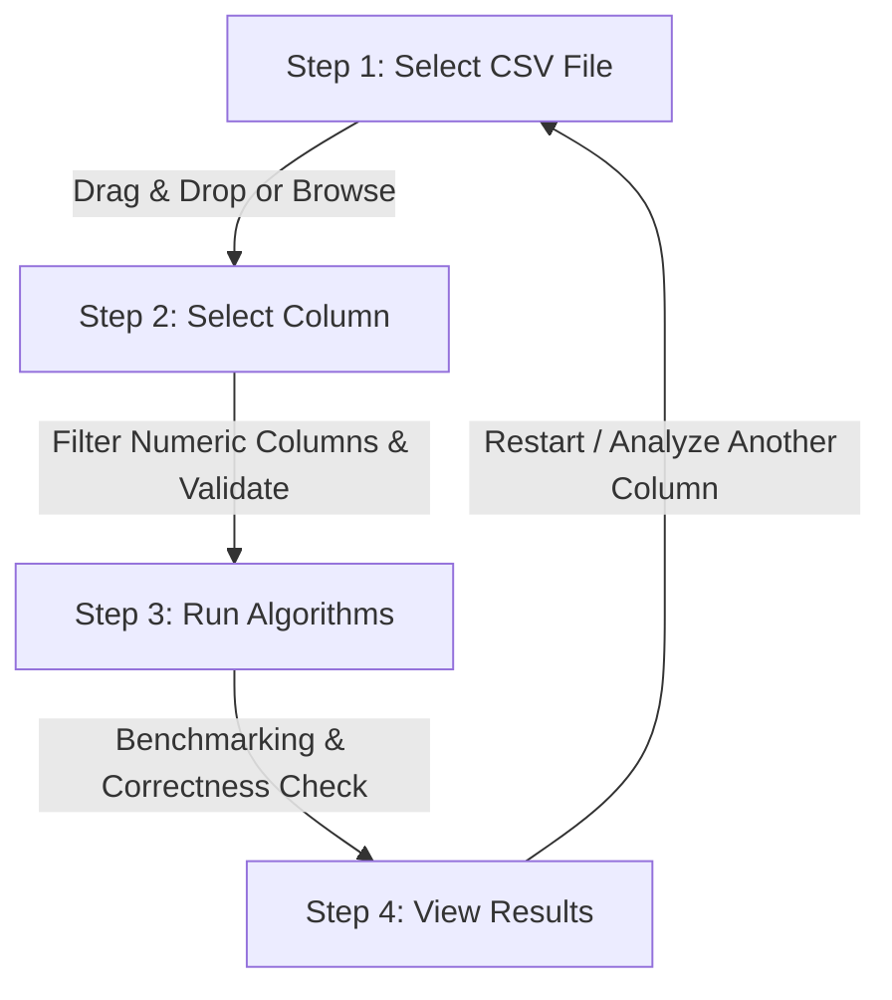

# Sorting Algorithm Performance Evaluator

An interactive, high-performance desktop application built in Java Swing designed to benchmark, analyze, and visualize the real-world execution speeds of fundamental sorting algorithms on custom CSV datasets.

---

## 📌 Overview

The **Sorting Algorithm Performance Evaluator** provides a streamlined 4-step wizard interface that allows users to upload custom CSV datasets, select numeric columns, and benchmark five major sorting algorithms against identical input data in real time.

With interactive animations, nanosecond-precision timing, automatic correctness verification, and responsive data visualization, the application makes empirical algorithm analysis intuitive and accessible.

---

## 👥 Group Members & Contributions

**Course:** IC4302 – Programming III  
**Department:** Department of ICT, Faculty of Technology, University of Colombo  
**Project:** Sorting Algorithm Performance Evaluator

| Member | Index Number | Name | Main Contribution | Java Files |
|---|---|---|---|---|
| **Member 1** | **2022T01591** | **D.S.W.I.G. Kurukularathne** | CSV file loading, dataset management and numeric column validation | `CsvLoader.java`, `CsvDataset.java` |
| **Member 2** | **2022T01533** | **H.M.S.M. Herath** | Sorting algorithm implementation and performance evaluation | `SortingAlgorithms.java`, `PerformanceEvaluator.java` |
| **Member 3** | **2022T01575** | **G.K. Savinda** | Java Swing user interface and visual components | `Main.java`, `UiKit.java`, `UiWidgets.java` |

---

## ✨ Key Features

- **Intuitive 4-Step Wizard**:
  1. **Upload CSV** (drag-and-drop or file picker)
  2. **Select Column** (automatic numeric type detection & validation)
  3. **Run Algorithms** (real-time progress monitoring)
  4. **View Results** (animated comparative bar chart & metrics)
- **Robust CSV Parser**:
  - Supports common CSV quoting rules, including commas inside quoted fields and escaped quotes (`""`). Quoted values spanning multiple lines are not supported.
  - Seamless handling of UTF-8 Byte Order Marks (BOM).
  - Automatically filters blank rows and validates numeric values.
- **Accurate Benchmarking**:
  - Measures execution times using `System.nanoTime()` for sub-millisecond precision.
  - Clones identical data arrays so every algorithm operates on identical inputs.
- **Data Integrity & Verification**:
  - Automatically runs an integrity check (`isSorted`) after each algorithm finishes to guarantee correctness.
- **Visual Analytics**:
  - Live execution status indicators for running algorithms.
  - Smooth animated horizontal bar charts comparing algorithm runtimes.
  - Highlights the overall fastest algorithm and displays speedup differentials.
  - Preview of sorted data array (first and last elements).
- **Custom Modern UI**:
  - Polished Java Swing interface featuring rounded panels, smooth transitions, modern color palettes, and responsive layouts without external UI framework dependencies.

---

## ⚡ Supported Sorting Algorithms

The application implements and evaluates five classic sorting algorithms:

| Algorithm | Best Case | Average Case | Worst Case | Space Complexity | Stable? | Description / Implementation Details |
|---|:---:|:---:|:---:|:---:|:---:|---|
| **Insertion Sort** | $O(n)$ | $O(n^2)$ | $O(n^2)$ | $O(1)$ | Yes | Builds the sorted array item by item; highly efficient on small or nearly sorted datasets. |
| **Shell Sort** | $O(n \log n)$ | $O(n^{1.3}-n^{1.5})$ | $O(n^2)$ | $O(1)$ | No | Generalization of insertion sort using diminishing gaps ($n/2, n/4, \dots, 1$) for long-range exchanges. |
| **Merge Sort** | $O(n \log n)$ | $O(n \log n)$ | $O(n \log n)$ | $O(n)$ | Yes | Divide-and-conquer algorithm that guarantees $O(n \log n)$ performance across all data distributions. |
| **Quick Sort** | $O(n \log n)$ | $O(n \log n)$ | $O(n^2)$ | $O(\log n)$ | No | Optimized with randomized pivot selection and tail-recursion elimination to prevent stack overflow on sorted inputs. |
| **Heap Sort** | $O(n \log n)$ | $O(n \log n)$ | $O(n \log n)$ | $O(1)$ | No | In-place comparison sort that structures data into a binary max-heap to extract elements in sorted order. |

---

## 🔄 Application Workflow



### Step 1: Select CSV File

- Drag and drop any `.csv` file into the upload drop zone, or click **Browse** to choose a file via the native file chooser.
- The built-in validator inspects the file structure, checks UTF-8 encoding, strips BOM headers, and checks for valid data rows.

### Step 2: Select Numeric Column

- All headers from the CSV are parsed and displayed.
- The application automatically analyzes column data types:
  - **Numeric columns** (integers, floating-point numbers, negative values, numbers with thousands separators) are enabled for sorting.
  - **Text/non-numeric columns** are flagged to prevent parsing errors.
- Displays dataset metrics (total row count, missing values handled).
- Warns users if datasets exceed large volumes (e.g. >200,000 items) to prevent system freeze on $O(n^2)$ algorithms.

### Step 3: Run Algorithms

- Executes the algorithms sequentially on dedicated background threads to keep the UI fluid and responsive.
- Displays real-time progress spinners and status cards for each algorithm.

### Step 4: View Results & Comparison

- **Fastest Algorithm Highlight**: Clear banner displaying the most efficient algorithm for the chosen dataset.
- **Animated Bar Chart**: Dynamic, color-coded visual comparison of execution times (in milliseconds).
- **Correctness Verification**: Displays a badge confirming that the sorted output was validated.
- **Sorted Sample Preview**: Shows a preview of the sorted values from lowest to highest.
- **Navigation Options**: Allows returning to choose a different column or loading a new dataset.

---

## 🛠️ System Requirements

- **Java Runtime Environment (JRE) / Java Development Kit (JDK)**: Version 17 or higher.
- **Operating System**: Windows, macOS, or Linux (cross-platform Swing GUI).
- **Display**: Minimum screen resolution of 1024 × 768 recommended.

---

## 🚀 How to Run

### Method 1: Pre-built Executable JAR (Recommended)

Run the packaged executable JAR directly from your terminal or command prompt:

```bash
java -jar SortingEvaluator.jar
```

*(On Windows, you can also double-click `SortingEvaluator.jar` if Java is associated with `.jar` files.)*

---

### Method 2: Compile & Run from Source Code

#### Windows (PowerShell):

```powershell
# Create output directory
New-Item -ItemType Directory -Force out

# Compile all source files
javac -encoding UTF-8 -d out src\*.java

# Launch the application
java -cp out Main
```

#### Linux / macOS (Terminal):

```bash
# Create output directory
mkdir -p out

# Compile all source files
javac -encoding UTF-8 -d out src/*.java

# Launch the application
java -cp out Main
```

---

### Optional: Running the Self-Test Suite

The project includes an automated console test suite that verifies algorithm correctness against `java.util.Arrays.sort()` across various edge cases (empty arrays, single items, reverse-sorted, duplicates, and negative numbers):

```bash
java -cp out AlgorithmSelfTest
```

---

## 📂 Source Code Architecture

```text
Sorting-Performance-App-main/
├── SortingEvaluator.jar           # Pre-compiled executable application
├── README.md                     # Application documentation
└── src/                          # Java source code
    ├── Main.java                 # Entry point, MainFrame window & wizard orchestration
    ├── UiKit.java                # Reusable UI components (stepper, buttons, cards, gradients)
    ├── UiWidgets.java            # Visual widgets (animated bar chart, column list, progress panel)
    ├── SortingAlgorithms.java    # Pure implementations of the 5 sorting algorithms
    ├── PerformanceEvaluator.java # Benchmarking engine, timing logic, and test runner
    ├── CsvLoader.java            # CSV reader with quoted-field and UTF-8 BOM support
    └── CsvDataset.java           # Data structures, numeric column validation and extraction
```
